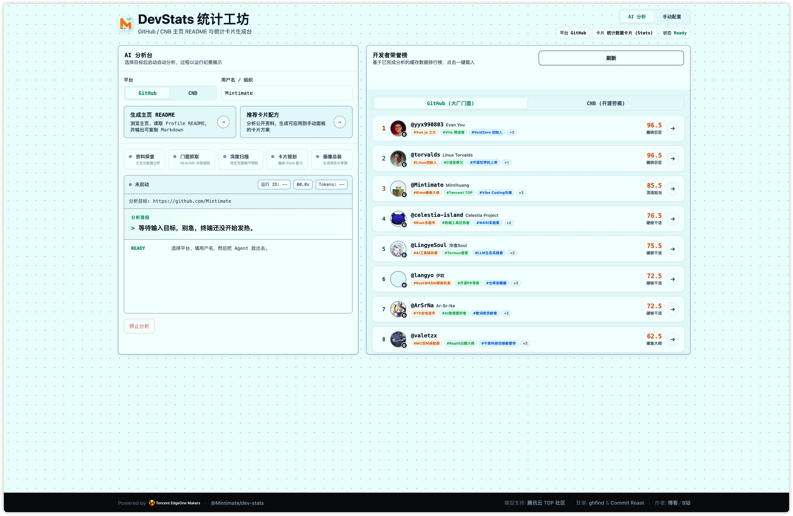
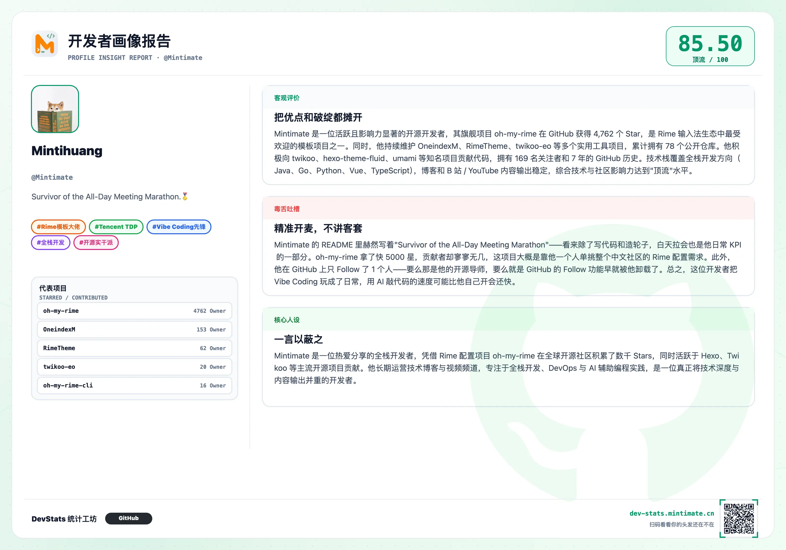
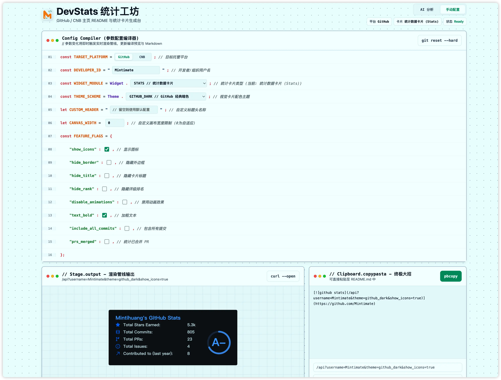

# DevStats

[English](README_EN.md) | 简体中文

本项目基于 [anuraghazra/github-readme-stats](https://github.com/anuraghazra/github-readme-stats) 核心代码进行扩展，新增了 CNB 平台支持、**AI Stats Agent 智能评估助手**、开发者排行榜等功能，适配 [腾讯云 EdgeOne Makers](https://makers.edgeone.ai) 平台部署。

原项目采用 Vercel 平台部署，本版本适配 EdgeOne Makers Cloud Functions，采用 Go 运行时实现后端，同时提供基于 Node.js 的 AI Agent 云函数层，兼具丰富的 Web 前端交互与极低的响应延迟。AI Stats Agent 的开发者画像分析灵感同样来自 [hikariming/ghfind](https://github.com/hikariming/ghfind)。

## 项目简介

- **AI Stats Agent**：集成大语言模型，能自动分析你的开源贡献，生成带有客观评分的专属评价，支持流式对话与 README 智能生成
- **开发者发现排行榜**：自动收录被评估的开发者，展示分数排名、平台标识与能力雷达，随时与其他顶级开发者对决
- **动态统计卡片**：展示 GitHub 或 CNB 数据（如提交次数、PR、Star 等）
- **多平台数据源**：原生支持 GitHub，同时无缝集成 CNB 平台数据抓取与卡片渲染
- **全新 React 交互面板**：支持多款卡片同屏展示与一键配置，防抖自动刷新并实时生成 Markdown/HTML 代码
- **多种主题与布局**：完整适配原项目的各种卡片参数、主题与紧凑/默认布局切换
- **Go Cloud Functions 后端**：采用 Go 运行时处理卡片渲染，提供超低冷启动与极速响应；Agent 与排行榜业务采用 Node.js 云函数
- **兼容原项目 API**：与原项目保持相同的查询参数和使用方式

## 界面展示



分享卡片



手动渲染 Stats 卡片:



## AI Stats Agent

AI Stats Agent 是本项目的核心亮点功能，基于大语言模型（LLM）构建，通过 EdgeOne Makers Node.js 云函数部署，提供开发者画像分析、README 自动生成和 Stats 卡片推荐等完整 AI 能力。

### 主要功能

#### 🤖 预设任务按钮驱动

Agent 面板采用**预设按钮**驱动，无需自由输入提示词。只需填入用户名并点击对应按钮，Agent 即会自动完成完整的分析链路，并通过 SSE（Server-Sent Events）实时流式展示运行纪要。

当前提供两个预设任务：

| 按钮 | 说明 |
|------|------|
| **生成主页 README** | 浏览主页、读取 Profile README，输出可直接复制的 Markdown 草稿 |
| **推荐卡片配方** | 分析公开资料，生成可应用到手动面板的 Stats 卡片方案 |

Agent 在执行过程中会依次调用以下工具：

| 工具 | 说明 |
|------|------|
| `browser_fetch` | 浏览用户主页，获取公开信号 |
| `inspect_github_user` | 拷打 GitHub 用户资料：仓库、语言、活跃度 |
| `inspect_cnb_user` | 拷打 CNB 用户资料：项目、组织、公开履历 |
| `fetch_github_profile_readme` | 读取 Profile README，参考用户自我介绍 |
| `compose_stats_recipe` | 生成个性化 Stats 卡片配方 |
| `compose_readme_draft` | 输出完整的 README Markdown 草稿 |

#### 📊 开发者评分体系

Agent 会基于公开数据对开发者进行多维度打分（每维度 1–20 分）：

| 维度 | 说明 |
|------|------|
| `maturity` | 账号成熟度与完整度 |
| `original_projects` | 原创项目质量与 Star 数 |
| `contributions` | PR、提交量与贡献深度 |
| `influence` | Star、Fork、Follower 影响力 |
| `activity` | 近期提交密度与活跃度 |
| `community` | 粉丝量与社区参与度 |

综合评分对应五档能力评级：

| 评级 | 分数范围 | 说明 |
|------|----------|------|
| 🔥 **夯** | 90–100 | 行业顶级影响力，核心技术突破 |
| ⭐ **顶流** | 80–89 | 明星开源项目领导者 |
| 💪 **高级** | 70–79 | 工程深度扎实，中等影响力 |
| 😐 **平庸** | 50–69 | 日常提交，缺乏旗舰作品 |
| 🌱 **入门** | 10–49 | 新手账号，多为 Fork 或 Demo |

#### 📝 README 智能生成

在"README 模式"下，Agent 会：

1. 获取现有 Profile README（GitHub 模式）
2. 分析仓库列表、语言分布、贡献历史
3. 撰写完整的个人介绍 Markdown（促销文案 + 客观评价 + 毒舌吐槽三段）
4. 推荐适合的 Stats 卡片组合并嵌入 README 中
5. 生成 `score`、`badges`、`dimension_scores` 等结构化画像数据

#### 🏆 开发者排行榜

每次 Agent 完成分析后，结果会自动写入 KV Blob 存储，并更新全局排行榜：

- 收录所有被评估的开发者（GitHub / CNB 双平台）
- 按综合得分降序排列，最多展示 Top 100
- 显示昵称、头像、分数、评级、标签
- 排行榜数据通过 `/agents/leaderboard` 接口提供，前端实时渲染

### Agent API 接口

| 接口 | 说明 |
|------|------|
| `POST /agents/chat` | 流式 SSE 对话，传入 `{ message, state, history }` |
| `GET /agents/chat?id=...` | 轮询会话结果（供非流式场景使用） |
| `POST /agents/stop` | 中断当前 Agent 运行 |
| `GET /agents/leaderboard` | 获取开发者排行榜 |
| `GET /agents/profile` | 获取指定用户的缓存分析结果 |

### Agent Skill 维护

`skills/dev-stats-agent/` 是 Agent 行为规范的唯一维护入口。平台路由、评分输出和 Stats 配方规则分别位于其 `references/` 目录；运行时代码由 `npm run sync:agent-skill` 生成到 `agents/chat/_skill.ts`，请勿直接修改生成文件。

```bash
npm run sync:agent-skill   # 修改 Skill 后同步运行时提示
npm run check:agent-skill  # 检查 Skill 与生成文件是否一致
```

`npm run dev` 和 `npm run build` 会自动同步，`npm run typecheck` 会拒绝未同步的 Skill 变更。更完整的仓库维护边界见 [`AGENTS.md`](./AGENTS.md)。

### 环境变量（Agent 功能）

Agent 功能需要额外配置大模型访问令牌：

| 变量名 | 说明 | 是否必须 |
|--------|------|----------|
| `OPENAI_API_KEY` | 大模型 API Key（支持 OpenAI 兼容接口） | ✅ Agent 功能必需 |
| `OPENAI_BASE_URL` | 自定义模型 API 地址（可接入国产模型） | 可选 |
| `OPENAI_MODEL` | 指定使用的模型名称 | 可选 |

## 快速开始

### 一键部署

您可以通过 [腾讯云 EdgeOne Makers](https://pages.edgeone.ai/zh) 一键部署。

直接点击此按钮一键部署：

[](https://console.cloud.tencent.com/edgeone/pages/new?repository-url=https%3A%2F%2Fgithub.com%2FMintimate%2Fdev-stats)

查看 [腾讯云 EdgeOne Makers 文档](https://pages.edgeone.ai/zh/document/product-introduction) 了解更多详情。

> **注意**：GitHub 卡片需要 `GITHUB_TOKEN`，推荐只允许读取公开仓库的 fine-grained PAT；CNB 公开数据源无需令牌。详见 [环境变量配置](#环境变量配置)。

### 手动部署

1. **Fork 本仓库**
2. **配置环境变量**（详见下方[环境变量配置](#环境变量配置)）
3. **部署到 EdgeOne Makers**：
   - 参考下方的详细部署步骤

## 环境变量配置

GitHub 卡片使用 GraphQL，需要令牌；Agent 的公开 REST 查询可以匿名访问，但速率限制更低。CNB 公开数据源无需令牌：

### 必需环境变量

- **`GITHUB_TOKEN`**：GitHub 个人访问令牌（Personal Access Token）
  - 用于读取公开统计数据，无需仓库写入权限或私有仓库访问权限
  - 获取方式见下方 [获取 GitHub Token](#获取-github-token最小权限)
  - 可配置 `GITHUB_TOKEN_1`、`GITHUB_TOKEN_2` 等备用令牌，卡片服务会在认证失效或限流时尝试下一个；Agent 使用第一个已配置的令牌。同一账号的多个 PAT 共享账号限额，不会叠加配额（[GitHub 限流说明](https://docs.github.com/en/graphql/overview/rate-limits-and-query-limits-for-the-graphql-api)）

### 可选环境变量

- **`CNB_API_TOKEN`**：CNB 访问令牌
  - 公开卡片通过 CNB 主站 Web JSON 接口读取，不要求令牌
  - 令牌仅作为未来受限 Open API 功能的后备，不会随主站公开请求发送
- 其他原项目环境变量: [原项目文档](https://github.com/anuraghazra/github-readme-stats#customization)。

### Agent 相关环境变量

使用 **AI Stats Agent** 功能时，还需配置大模型访问凭据：

- **`OPENAI_API_KEY`**：大模型 API Key（支持 OpenAI 兼容接口）✅ **Agent 功能必需**
- **`OPENAI_BASE_URL`**：自定义模型 API 地址，可接入国产模型或其他兼容服务（可选）
- **`OPENAI_MODEL`**：指定使用的模型名称（可选）
- **`PUBLIC_SITE_URL`**：部署站点的公开 HTTPS 地址，例如 `https://your-project.pages.dev`。Agent 导出的 README Stats 卡片会优先使用该域名的绝对 URL。未配置时，仅同源浏览器请求可作为安全回退；建议生产环境始终配置。

> **注意**：EdgeOne Makers 在部署后加载环境变量，每次更改环境变量后需要重新触发部署使变量生效。

### TDP OIDC 快捷账号导入（可选）

配置后，AI 分析台会显示“从 TDP 获取账号”入口。该功能只通过一次性 OIDC 流程读取用户在 `tdp.fan` 绑定的 GitHub / CNB 用户名，用于快速填充分析目标；不会创建站内登录态，也不会持久化 OIDC Token。

- **`TDP_OIDC_CLIENT_ID`**：TDP 开放平台分配的 Client ID
- **`TDP_OIDC_CLIENT_SECRET`**：TDP 开放平台分配的 Client Secret，仅配置在服务端
- **`TDP_OIDC_COOKIE_SECRET`**：至少 32 个字符的独立随机值，用于签名短期 OIDC Cookie
- **`TDP_OIDC_ISSUER`**：可选，默认 `https://tdp.fan/oidc`
- **`TDP_OIDC_REDIRECT_URI`**：可选，默认根据 `PUBLIC_SITE_URL` 生成 `/api/auth/tdp/callback`

在 TDP 开放平台登记的生产回调地址必须与以下地址完全一致：

```text
https://your-domain.example/api/auth/tdp/callback
```

本地开发可登记 `http://127.0.0.1:8088/api/auth/tdp/callback`，并通过 `openssl rand -base64 32` 生成独立的 Cookie Secret。应用只请求 `openid tdp:social` Scope，并使用 Authorization Code、PKCE S256、`state` 与 `nonce` 校验。

## 缓存策略

本项目会在函数响应中返回 `Cache-Control`，并在 `edgeone.json` 中为主要卡片接口配置 Pages 缓存：

- `/api`：默认缓存 1 天
- `/api/top-langs`：默认缓存 6 天
- `/api/pin`：默认缓存 10 天
- `/api/gist`：默认缓存 2 天
- `/api/wakatime`：默认缓存 1 天
- `/api/streak`、`/api/contribution-calendar`：默认缓存 12 小时
- `/api/recent-activity`：默认缓存 1 小时
- `/api/profile-summary`、`/api/repo-languages`、`/api/org`：默认缓存 1 天

状态接口不会配置平台缓存，避免 PAT 状态、可用性检查等动态结果被长期缓存。高流量公开实例仍可在自定义域名前增加 EdgeOne CDN / Cloudflare 等 CDN 层，用于更细粒度的缓存命中、清理和观测。

例如：我使用 EdgeOne 的站点加速再次代理 EdgeOne Makers，可以获得额外的 CDN 缓存控制：


对应的缓存规则:


## 技术架构

本项目是一个全栈 Web 应用程序：
- **前端界面**：采用 React 构建，提供卡片预览、Stats Agent 对话、代码生成与全局排行榜。
- **Agent 与业务服务 (TS/Node.js)**：位于 `agents/` 目录，通过 EdgeOne Makers 部署为云端 API，处理 OpenAI / 大模型接口调用、SSE 流式响应与 KV 缓存/排行榜读写。内置受信任的头像代理，解决前端跨域限制。
- **卡片渲染引擎 (Go)**：位于 `cloud-functions/internal`，采用 Go 语言实现极速 SVG 渲染，完美兼容原项目参数，并适配 CNB 平台。

**Go 版渲染引擎当前覆盖的卡片接口：**

- `/api` - GitHub 统计卡片
- `/api/top-langs` - 语言占比卡片
- `/api/pin` - 仓库卡片
- `/api/gist` - Gist 卡片
- `/api/wakatime` - WakaTime 统计卡片
- `/api/streak` - 连续贡献统计卡片
- `/api/profile-summary` - 开发者资料概览卡片
- `/api/contribution-calendar` - 年度贡献日历卡片
- `/api/recent-activity` - 最近公开动态卡片
- `/api/repo-languages` - 指定仓库语言占比卡片
- `/api/org` - GitHub 组织统计卡片
- `/api/status/up` - PAT 可用性检查
- `/api/status/pat-info` - PAT 状态详情

Go Cloud Functions 是当前主实现，Node Functions 已移除。当前 Go 版本优先覆盖核心数据与 SVG 输出，常用主题、布局和展示参数会继续按原项目行为补齐。

### CNB 数据源

在普通卡片 URL 中加入 `platform=cnb` 即可切换到 CNB；不传该参数时仍使用 GitHub，原有链接无需修改。

```md


```

CNB 当前支持 `/api`、`/api/top-langs`、`/api/pin`、`/api/streak`、`/api/profile-summary`、`/api/contribution-calendar`、`/api/recent-activity` 和 `/api/repo-languages`。Gist 与组织统计没有等价数据源，继续仅支持 GitHub。CNB 语言接口只提供主/次语言而非字节数，语言卡按仓库出现次数加权。

## 获取 GitHub Token（最小权限）

默认推荐 **fine-grained PAT，仅访问公开仓库，不添加额外权限**：

1. 进入 [Fine-grained personal access tokens](https://github.com/settings/personal-access-tokens/new)，创建项目专用令牌并设置有效期。
2. `Repository access` 选择 `Public repositories only`，不要选择私有仓库。
3. 不添加仓库、组织或账号权限，保留 GitHub 自动提供的公开资源只读访问。
4. 将令牌保存到 EdgeOne Makers 的服务端环境变量 `GITHUB_TOKEN`。不要将令牌放入前端源码或静态发布目录。

GitHub 官方说明 fine-grained PAT 默认包含所有公开仓库的只读访问；本项目的公开统计无需 `repo` 或 `read:user`。参见 [PAT 权限管理](https://docs.github.com/en/authentication/keeping-your-account-and-data-secure/managing-your-personal-access-tokens) 和 [GraphQL 认证](https://docs.github.com/en/graphql/guides/forming-calls-with-graphql)。

如果必须使用 Classic PAT，GitHub 的 GraphQL 文档要求公开仓库访问使用 `public_repo`；它仍包含公开仓库写入能力，因此优先使用上面的 fine-grained 方案。不要授予完整 `repo`、组织管理或 `gist` 写入权限。`read:user` 仅在确实需要私有/内部贡献统计时另行评估，并受 GitHub 可见性设置限制；它不是公开统计的必需权限。参见 [Scope 定义](https://docs.github.com/en/apps/oauth-apps/building-oauth-apps/scopes-for-oauth-apps) 和 [贡献统计字段](https://docs.github.com/en/graphql/reference/users#contributionscollection)。

若部署曾暴露 `/.env`，应立即撤销并更换其中的全部凭据，包括 GitHub PAT、大模型 API Key、OIDC Client Secret 和 Cookie Secret；只删除文件或重新部署无法让旧凭据失效。更新平台环境变量后重新部署，并清理 CDN 中已缓存的敏感文件及仍可访问的旧部署。

本次加固不调整 Blob 存储名称、路径、JSON 结构和缓存读写逻辑，已有画像与榜单沿用原有处理方式。GitHub 公开资源过滤作用于后续 API 采集，不会自动清洗历史缓存。若确认某个历史结果包含私有数据，应针对该用户清理并重新分析。

## 部署到 EdgeOne Makers

1. 登录腾讯云 EdgeOne 控制台，创建新的 Pages 项目
2. 选择 GitHub 作为代码源并关联本仓库，构建命令使用 `npm run build`，静态输出目录使用 `dist`
3. 在项目的环境变量中设置 `GITHUB_TOKEN` 为上一步获取的 GitHub Token
4. 由于 EdgeOne Makers 在部署后加载环境变量，设置完成后需要再次触发部署使变量生效

本地发布使用 `edgeone makers deploy --name dev-stats`，让 CLI 先构建再发布；不要传入 `.` 或项目根目录，也不要把整个源码目录作为静态文件上传。`.gitignore` 不能阻止静态服务器读取已发布的文件。`npm run build` 会在构建前后检查 `public/` 和 `dist/`，拒绝环境变量文件、源码目录、私钥、source map 和符号链接；全站中间件也会拦截敏感路径。运行 `edgeone makers build` 后，可用 `npm run check:deployment` 额外检查生成的静态产物及中间件覆盖范围。

当前已核对的 EdgeOne CLI 1.6.42 本地开发中间件与生产运行存在差异，本地响应不能证明生产防护已生效。发布前应执行产物检查，发布后确认 `/.env`、`/.git/config` 等敏感路径返回 404。

## 使用说明

部署完成后，访问您的 EdgeOne Makers 域名即可看到使用文档。API 接口与原项目完全兼容。

### 可用接口

- `/api` - GitHub 统计卡片
- `/api/top-langs` - 语言占比卡片
- `/api/pin` - 仓库卡片
- `/api/gist` - Gist 卡片
- `/api/wakatime` - WakaTime 统计卡片
- `/api/streak` - 连续贡献统计卡片
- `/api/profile-summary` - 开发者资料概览卡片
- `/api/contribution-calendar` - 年度贡献日历卡片
- `/api/recent-activity` - 最近公开动态卡片
- `/api/repo-languages` - 指定仓库语言占比卡片
- `/api/org` - GitHub 组织统计卡片

详细参数请参考 [原项目文档](https://github.com/anuraghazra/github-readme-stats/blob/master/readme.md)。

## 示例卡片

将以下代码复制到你的 README 文件中（替换为您的域名和用户名）：

```md


```

更多样式和参数配置(环境变量)请参考 [原项目文档](https://github.com/anuraghazra/github-readme-stats#customization)。

## 相关链接

- [原项目仓库](https://github.com/anuraghazra/github-readme-stats) - anuraghazra/github-readme-stats
- [ghfind](https://github.com/hikariming/ghfind) - AI Stats Agent 开发者画像分析灵感来源
- [EdgeOne Makers 文档](https://pages.edgeone.ai/zh/document/product-introduction)
- [EdgeOne Makers 控制台](https://console.cloud.tencent.com/edgeone/pages)

## License

本项目基于原项目的 MIT 协议开源。详见 [LICENSE](LICENSE) 文件。
